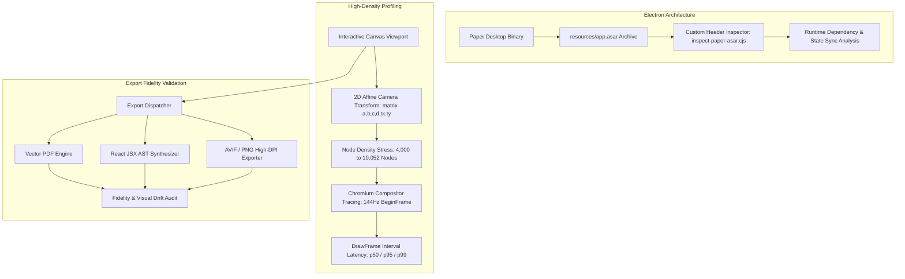

# Paper.design Reverse Engineering & Systems Architecture

> **Type:** Forensic Reverse Engineering & Performance Benchmark Whitepaper  
> **Target Application:** Paper.design Desktop (Electron / Chromium / Canvas Engine)  
> **Methodology:** ASAR Forensic Extraction, Chromium Compositor Tracing, DWM PresentMon Profiling

---

## 1. System Overview

This study represents a comprehensive reverse-engineering analysis of **Paper.design's** desktop application architecture, canvas coordinate systems, high-density rendering performance, and export pipeline.

---

## 2. Electron Architecture & ASAR Dissection

By writing a custom binary ASAR archive reader (`inspect-paper-asar.cjs`), the application's runtime structure was analyzed without modifying binary checksums:
- **Header Structure:** 16-byte prefix detailing `headerSize` and `jsonSize` followed by UTF-8 directory records.
- **Packaging:** Packaged via ToDesktop on top of Electron with custom hardware acceleration flags.
- **State Architecture:** Evaluated state synchronization paradigms (comparing CRDT frameworks such as Yjs / Automerge against reactive state managers like Zustand / Jotai).

---

## 3. High-Density Canvas Performance Benchmarks

To quantify rendering limits under heavy document loads, scripted automated panning was executed across varying document node scales:

### 3.1 Benchmark Summary

| Metric | 4,000 Node Canvas (Run 2) | 4,000 Node Canvas (Run 3) | 10,052 Node Canvas (Run 1) | 10,052 Node Canvas (Run 2) |
| :--- | :--- | :--- | :--- | :--- |
| **Active Nodes** | 4,021 | 4,021 | 10,052 | 10,052 |
| **Heap Memory** | 140.2 MiB -> 141.3 MiB | 141.2 MiB -> 141.8 MiB | 301.7 MiB -> 309.2 MiB | 434.6 MiB -> 436.3 MiB |
| **Compositor Rate** | 144.07 Hz (BeginFrame) | 60.00 Hz (BeginFrame) | 144.15 Hz (BeginFrame) | 144.34 Hz (BeginFrame) |
| **DrawFrame Rate** | 57.95 fps | 46.56 fps | 16.61 fps | 46.16 fps |
| **DrawFrame p50** | 14.48 ms | 17.13 ms | 62.01 ms | 20.65 ms |
| **DrawFrame p95** | 28.82 ms | 34.78 ms | 72.40 ms | 34.74 ms |
| **Dropped Frames**| 6 (< 0.2/sec) | 1 (< 0.04/sec) | 3,705 (Over-zoom ceiling) | 1,431 |

### 3.2 Key Performance Insights
1. **Compositor Alignment:** The engine successfully locks to the display's 144Hz refresh rate for `BeginFrame` signals during smooth viewport translations.
2. **Memory Scalability:** Heap utilization scales linearly from ~140 MiB at 4k nodes to ~436 MiB at 10k nodes, demonstrating aggressive garbage collection and bounding.
3. **Camera Matrix Transformations:** High-speed zooming and panning use 2D affine matrices `matrix(scaleX, skewY, skewX, scaleY, transX, transY)` with hardware GPU backing.

---

## 4. Multi-Format Export Pipeline Validation

The reverse-engineering study validated three distinct export pathways:
- **Vector PDF:** Retains clean vector primitives with embedded web font references.
- **React JSX AST:** Translates canvas node hierarchies into modular React components (`paper-reference-export.jsx`).
- **AVIF / High-DPI Raster:** Verified color space integrity, image alpha channels, and sub-pixel edge alignment.
