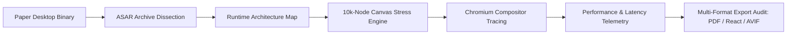

# Paper.design Reverse Engineering Case Study

<p align="center">
  <strong>Deep Reverse Engineering & Performance Benchmark Study of Paper.design Desktop (Electron ASAR Dissection, 10k-Node Canvas Benchmarking & Export Architecture).</strong>
</p>

---

## Executive Summary

This repository publishes the complete technical whitepaper, performance telemetry data, and reverse-engineering findings of **Paper.design's** desktop application.

By leveraging low-level binary ASAR parsing, Chromium compositor trace event analyzers, and high-density canvas stress testing (up to 10,052 visual nodes), this study provides deep architectural insights into how modern professional design tools manage infinite canvas scaling, 144Hz compositor synchronization, and multi-format export pipelines.

---

## Research Highlights

- **Custom ASAR Binary Reader:** Non-invasive header parsing tool (`inspect-paper-asar.cjs`) that unpacks runtime dependencies, build targets, and state synchronization bindings.
- **10k-Node Canvas Benchmarks:** Comprehensive performance telemetry capturing `BeginFrame`, `DrawFrame`, and `DroppedFrame` intervals across 4k and 10k visual element workloads.
- **Compositor Trace Telemetry:** Analysis of 144Hz refresh-rate locking, showing p50 frame intervals of 14.48ms under active 4,000-node panning workloads.
- **Export Pipeline Architecture:** Verification of vector PDF rendering, React JSX component translation, and AVIF raster fidelity.

---

## System Architecture



For the complete technical breakdown and benchmark tables, see [ARCHITECTURE.md](./ARCHITECTURE.md).

---

## Directory Structure

```text
├── ARCHITECTURE.md          # Full architectural whitepaper and benchmark analysis
├── LICENSE                  # Strict Research Showcase License
├── benchmarks/              # Telemetry logs and performance summaries
│   ├── paper-performance-summary.json
│   ├── paper-export-summary.json
│   └── paper-export-validation-20261021.json
└── scripts/                 # Custom analysis and measurement tooling
    ├── inspect-paper-asar.cjs        # Binary ASAR header reader
    ├── paper-trace-analyzer.cjs      # Chromium compositor trace analyzer
    └── paper-native-frame-analyzer.py # Frame interval and latency calculator
```

---

## Showcase Edition Notice

> **Note:** This repository is an architectural showcase and research study. All trademarks, logos, and brand names are the property of their respective owners. Proprietary binaries and copyrighted runtime assets are excluded.

---

## Author & Copyright

**Researched and Authored by Kartik**  
Copyright (c) 2026 Kartik. All Rights Reserved.
